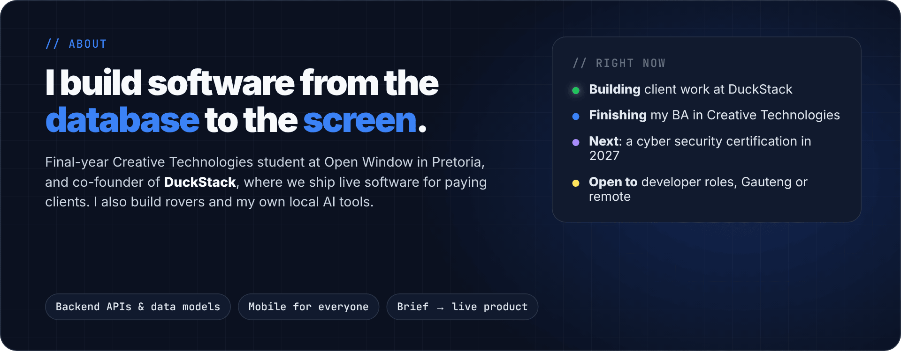
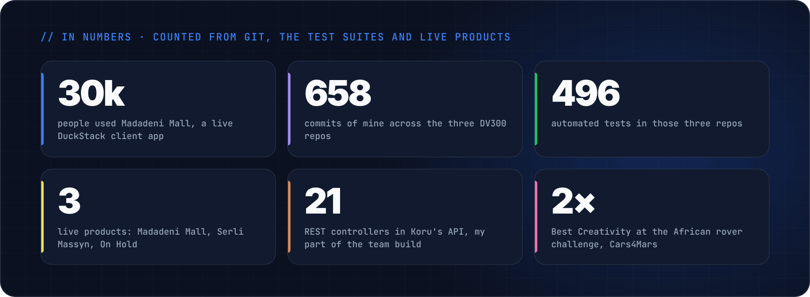
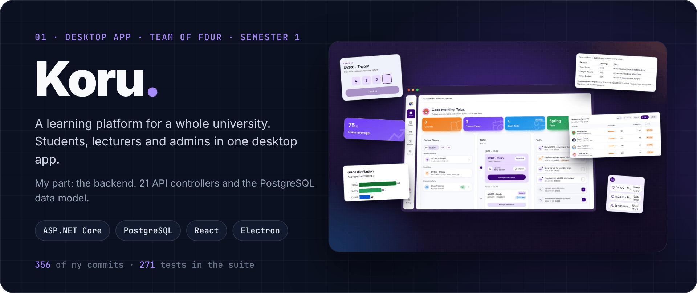
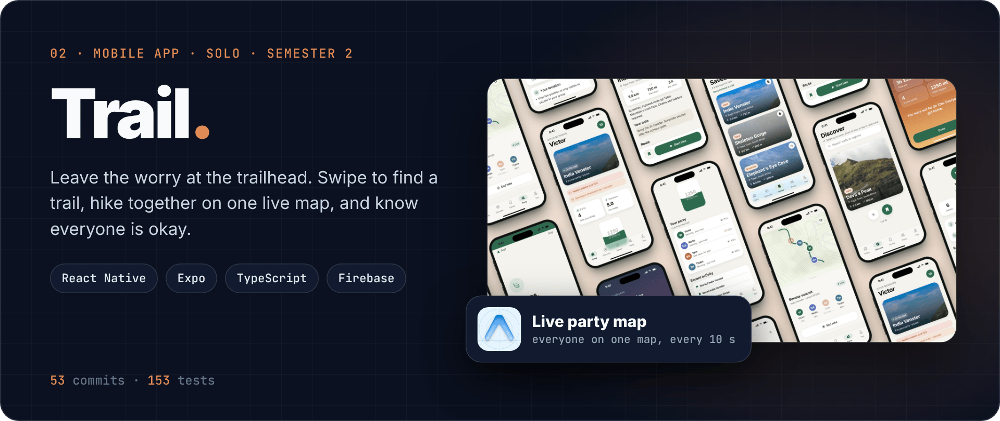
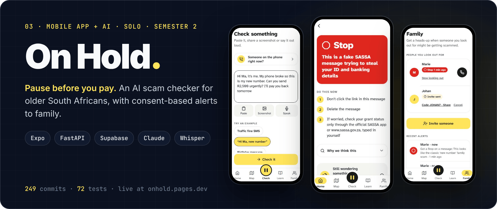

  &nbsp;
  &nbsp;
  

## DV300 portfolio: my main three

<b>Open the repos:</b> <a href="https://github.com/wrapperik/koru">Koru</a> · <a href="https://github.com/victordupreez0/Trail">Trail</a> · <a href="https://github.com/victordupreez0/On-Hold">On Hold</a> · <a href="https://onhold.pages.dev">try On Hold live</a>

## Other work

- **[Madadeni Mall](https://jobsmadadenimall.co.za)** · live job portal for a DuckStack client, used by **30,000 people**. Locals apply from their phones in English or isiZulu; the shops shortlist and hire from an admin console.
- **Cars4Mars** · African rover challenge with team Techne-Cality. Best Creativity in 2025 and 2026, Top 10 of 100+ teams in 2025.
- **[StudentGigs](https://github.com/victordupreez0/Summative_StudentGigs)** · student job marketplace I built solo, from auth to live messaging.
- **[Serli Massyn](https://serlimassyn.co.za)** · live website for a psychometrist's practice.
- **Atlas** · my local AI assistant with persistent memory that runs my calendar, inbox and tasks.

Open to developer roles and internships · Gauteng or remote · <a href="mailto:victor.dupreez0@gmail.com">victor.dupreez0@gmail.com</a>

